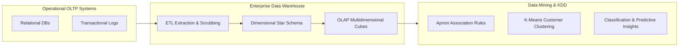

<p align="center">
  
</p>

<p align="center">
  
  
  
  
  
</p>

---

## Executive Summary / Overview
### Problem Statement & Context
Enterprise data distributed across disparate OLTP systems cannot efficiently support high-throughput analytical querying. Without an architected Data Warehouse and robust Data Mining (KDD) pipeline, organizations cannot uncover latent customer purchase behaviors, optimize supply chain velocity, or compute fast multi-dimensional aggregations.

### Solution Overview
This repository documents a comprehensive **Data Warehousing & Mining (DWM)** architecture designed by Surya Teja. Encapsulated in the extensive **15.4 MB project treatise (`DWM_PROJECT_REPORT-SuryaTeja.pdf`)**, the project covers the full Knowledge Discovery in Databases (KDD) lifecycle: Extraction-Transformation-Loading (ETL), Star and Snowflake schema design, OLAP hypercube operations, and data mining algorithms including Apriori association rule mining and cluster segmentation.

---

## Interactive Table of Contents
- [Executive Summary / Overview](#executive-summary--overview)
- [Key Features & Capabilities](#key-features--capabilities)
- [System Architecture / Pipeline](#system-architecture--pipeline)
- [Tech Stack Breakdown](#tech-stack-breakdown)
- [Reproducible Quickstart & Setup](#reproducible-quickstart--setup)
- [Project Directory Layout](#project-directory-layout)
- [Author & Contributions](#author--contributions)

---

## Key Features & Capabilities
- **Dimensional Modeling Architecture:** Formal specification of Star and Snowflake schemas, separating high-volume fact transactions from dimension hierarchies.
- **OLAP Hypercube Analytical Engine:** Support for Roll-up, Drill-down, Slice, Dice, and Pivot multi-dimensional aggregation operations.
- **Frequent Itemset & Association Rule Mining:** Algorithmic extraction of support, confidence, and lift metrics utilizing Apriori principles.
- **Unsupervised Cluster Segmentation:** Mathematical grouping of high-dimensional customer vectors to discover latent purchasing clusters.

---

## System Architecture / Pipeline


---

## Tech Stack Breakdown
| Layer | Technology | Details |
| :--- | :--- | :--- |
| **Languages** | SQL, Python, R | Query formulation, ETL orchestration, and mining scripts |
| **Libraries** | Scikit-Learn, Pandas, MLxtend | Apriori association rules, clustering, dimensional aggregations |
| **Tools** | Enterprise DW Engines, OLAP Tools | Star/Snowflake schemas, multidimensional cubes |
| **Architecture** | Kimball Dimensional Modeling / KDD | End-to-end Knowledge Discovery in Databases pipeline |

---

## Reproducible Quickstart & Setup
```bash
# 1. Clone repository
git clone https://github.com/suryateja-155/DWM-Project.git
cd DWM-Project

# 2. View the comprehensive report
# Open DWM_PROJECT_REPORT-SuryaTeja.pdf in any standard PDF reader:
start DWM_PROJECT_REPORT-SuryaTeja.pdf
```

---

## Project Directory Layout
```text
DWM-Project/
├── DWM_PROJECT_REPORT-SuryaTeja.pdf   # Complete 15.4 MB engineering report and system analysis
└── README.md                         # Architecture summary, OLAP pipeline and methodology guide
```

---

## Author & Contributions

**Gettupalli Surya Teja**  
- GitHub Profile: [@suryateja-155](https://github.com/suryateja-155)  
- Portfolio Index: [Gettupalli-Surya-Teja](https://github.com/suryateja-155/Gettupalli-Surya-Teja)

Contributions, issue reports, and feedback are always welcome! Feel free to open an issue or pull request.

<p align="center">
  
</p>
